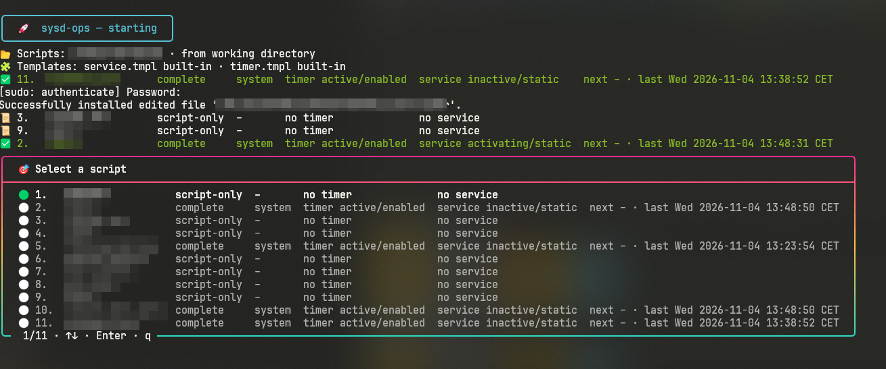
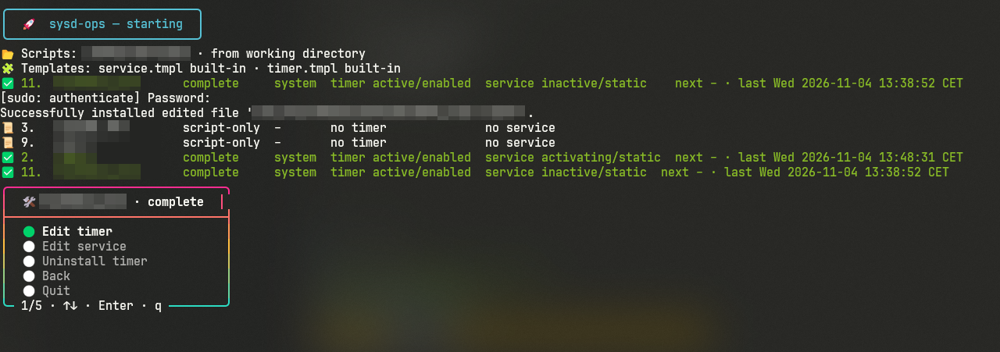

# ⏰ sysd-ops

sysd-ops finds the shell scripts in a directory and shows which of them have a systemd
timer and service of the same name. It installs new timers from templates, opens existing
units in your editor, and uninstalls timers, all from one small command-line tool.



## ✨ Features

- 🔎 **Discovery**: finds `.sh` files and shell files without extension, optionally in subdirectories.
- 🧭 **Matching**: pairs each script with `<name>.timer` and `<name>.service` in the user and system scope.
- 🎯 **Menu**: picks a script and an action with the arrow keys and rereads the list after every action.
- 📋 **List**: prints a table, details with `--verbose`, or JSON with `--json`.
- 🧙 **Install**: a wizard or the `install` command renders the missing units from templates, validates them, and enables the timer.
- 🧩 **Templates**: `service.tmpl` and `timer.tmpl` are replaceable; the wizard asks only for fields they use.
- ✏️ **Edit**: opens units through `systemctl edit` in the configured editor, as full file or drop-in.
- 🗑️ **Uninstall**: disables and removes a timer and optionally its service, never the script.
- 🛡️ **Safety**: never overwrites units, deletes only in the admin unit directories, and runs system changes through `sudo`.
- ⏭️ **Dry run**: `--dry-run` shows every command and file without changing anything.

## 📦 Install

Requirements: Linux with systemd (`systemctl`, `systemd-analyze`, `loginctl`), `sudo` for
system units, an editor such as `nano`, and Go 1.26 or newer to build.

```fish
git clone https://github.com/tf4482/sysd-ops.git
cd sysd-ops
make build
sudo make install
```

## 🧭 Name matching

- A script is a regular file ending in `.sh`, or a file without extension whose first line
  (at most 256 bytes) is a shebang for `sh`, `bash`, `dash`, `zsh`, `ksh`, or `fish`,
  directly or through `env`.
- Symlinks count only when their target is a regular file; the target is used.
- `--recursive` or `recursive: true` searches subdirectories; hidden ones are skipped.
- The script name is the file name without `.sh`: `backup.sh` → `backup`.
- Only `backup.timer` and `backup.service` match: exact, case-sensitive, no prefixes.
  `backup2.timer`, `backup@.timer`, and `backup@x.timer` do not count.
- Two scripts with the same name (`a/backup.sh` and `b/backup.sh`, or `backup.sh` and
  `backup`) are **ambiguous**: shown with a warning, without actions.
- Names with characters other than `A-Z a-z 0-9 : _ . -`, names starting with `-` or `.`,
  and names containing `..` are shown as not installable.

## 🚦 States

A unit exists when systemd reports `LoadState=loaded`. With `scope: all`, a script with
units in both scopes gets one row per scope.

| State | Meaning | Actions |
| --- | --- | --- |
| `script-only` | Neither timer nor service | Install |
| `complete` | Timer and service | Edit timer, edit service, uninstall timer |
| `service-only` | Service without timer | Install the timer, edit service |
| `timer-only` | Timer without service (broken) | Install the service, edit timer, uninstall timer |

In the menu, choosing a script opens only the actions that fit its state:



## 🧩 Templates

Units are rendered with Go `text/template` from `service.tmpl` and `timer.tmpl`. Each file
is taken from the first place that has it:

1. `--template-dir <path>`
2. `settings.template_dir`
3. `$XDG_CONFIG_HOME/sysd-ops/templates/` (else `~/.config/sysd-ops/templates/`)
4. the built-in [templates/](templates/), which reproduce the original example units exactly

Unknown fields and syntax errors stop the run with file, line, and reason. Rendered units
must contain `[Unit]` and `[Service]` or `[Timer]` and pass `systemd-analyze verify`.
Install also refuses units that systemd already knows in the target scope, for example a
package unit in `/usr/lib/systemd`. Schedule options need the matching field in `timer.tmpl`.

| Field | Content |
| --- | --- |
| `.Name` | Script name without extension |
| `.Description` | `Run <name>` or `Timer for <name>`; `%` escaped |
| `.ScriptPath` | Absolute script path, symlinks resolved, escaped and quoted as one `ExecStart=` word |
| `.Interpreter` | Absolute interpreter from the shebang, escaped like `.ScriptPath`; `env` resolved via `PATH`; `/bin/bash` without shebang |
| `.ExecStart` | Interpreter, shebang arguments, and script path, escaped and quoted for systemd |
| `.WorkDir` | Directory of the script; `%` escaped |
| `.User` | Account for `User=`; system scope only |
| `.Scope` | `user` or `system` |
| `.OnCalendar` `.OnBootSec` `.OnUnitActiveSec` `.OnUnitInactiveSec` | Schedule; empty when not chosen |
| `.Persistent` | `true` or `false` |
| `.AccuracySec` `.RandomizedDelaySec` | Default `100ms` and `0` |
| `.Created` | Date of rendering |
| `.Tool` | `sysd-ops <version>` |

Example `~/.config/sysd-ops/templates/service.tmpl` that runs the script directly in its
directory; the script then needs the execute bit, and the install offers `chmod u+x`:

```text
[Unit]
Description={{.Description}}

[Service]
Type=oneshot
WorkingDirectory={{.WorkDir}}
ExecStart={{.ScriptPath}}
# {{.Tool}}, {{.Created}}
```

The built-in service keeps `Wants=` and `After=network-online.target` in both scopes. User
managers have no such target, so in user units these lines have no effect.

## 🔐 sudo, polkit, and linger

- System units are written with `sudo install -m 0644`, deleted with `sudo rm`, and
  changed with `sudo systemctl`; the program itself never runs as root.
- `systemctl show` reads without privileges; system edits run
  `sudo env SYSTEMD_EDITOR=<editor> systemctl edit`.
- Uninstall deletes only unit files that systemd reports directly in
  `/etc/systemd/system/` or `~/.config/systemd/user/`. Package units are only disabled;
  masking is offered instead.
- User timers run only while you are logged in unless lingering is on. sysd-ops prints
  `loginctl enable-linger <user>` when `loginctl show-user` reports it off.

## ⚙️ Configuration

The first existing file wins: `config.yml` beside the executable, then
`~/.config/sysd-ops/config.yml`. Without a file, the first run creates the second one
from [config.example.yml](config.example.yml) and exits 1. Unknown or missing keys are errors.

| Setting | Description | Default |
| --- | --- | --- |
| `settings.directory` | Script directory; empty uses the working directory, `--dir` overrides it | `""` |
| `settings.recursive` | Search subdirectories | `false` |
| `settings.editor` | Editor for `systemctl edit`; `$EDITOR` is ignored | `nano` |
| `settings.scope` | Units shown: `system`, `user`, or `all` | `all` |
| `settings.install_scope` | Default install scope: `user` or `system` | `user` |
| `settings.template_dir` | Template directory; empty uses the lookup above | `""` |
| `settings.command_timeout_seconds` | Deadline per `systemctl`, `systemd-analyze`, and `loginctl` call | `30` |

## 🚀 Usage

| Command | Purpose |
| --- | --- |
| `sysd-ops` | Menu in a terminal, table elsewhere |
| `sysd-ops list [--json] [--verbose]` | Table, JSON, or details |
| `sysd-ops install <name> [options]` | Create and enable the missing units |
| `sysd-ops edit-timer <name> [--dropin]` | Edit the timer |
| `sysd-ops edit-service <name> [--dropin]` | Edit the service |
| `sysd-ops uninstall <name> [--yes]` | Remove the timer, then ask about the service |

| Option | Purpose |
| --- | --- |
| `--dir <path>` | Script directory |
| `--recursive` | Search subdirectories |
| `--system`, `--user`, `--all` | Scopes shown and searched |
| `--template-dir <path>` | Template directory |
| `--dry-run` | Show commands and files, change nothing |
| `--yes` | Confirm automatically; the service stays on uninstall |
| `--no-color` | No colors |
| `--version` | Version |
| `--scope user\|system` | Install scope |
| `--schedule <preset>` | `default`, `hourly`, `daily@HH:MM`, `weekly@Mon@HH:MM`, `monthly`, `oncalendar:<expr>` |
| `--on-boot <span>` | `OnBootSec=` |
| `--every-inactive <span>` | `OnUnitInactiveSec=`, interval after a run finished |
| `--every-active <span>` | `OnUnitActiveSec=`, interval after a run started |
| `--user-account <name>` | `User=` of system units, default the current user |

Without `--schedule` and span options the `default` preset applies (`OnBootSec=60s`,
`OnUnitInactiveSec=15s`). Calendar presets combine with `--on-boot`. Calendar expressions
and spans are checked with `systemd-analyze`. The `install` command asks no questions
except confirmations; the menu's wizard asks for every value the templates use.

Show the scripts in a directory:

```fish
sysd-ops list --dir ~/bin
```

```text
🚀 sysd-ops — starting
📂 Scripts: /home/user/bin · from flag
✅ 1.  backup   complete     user  timer active/enabled  service inactive/static  next Thu 2026-11-05 03:00:00 CET · last –
⚠️ 2.  cleanup  script-only  –     no timer              no service               ambiguous: 2 scripts share the name cleanup
⚠️ 3.  cleanup  script-only  –     no timer              no service               ambiguous: 2 scripts share the name cleanup
📜 4.  report   script-only  –     no timer              no service
✅ 4 scripts listed
```

Preview a weekly system timer, then install it:

```fish
sysd-ops install report --scope system --schedule weekly@Mon@07:00 --dry-run
sysd-ops install report --scope system --schedule weekly@Mon@07:00
```

Run a script every 10 minutes after the previous run finished, starting 2 minutes after boot:

```fish
sysd-ops install sync --every-inactive 10min --on-boot 2min --yes
```

Edit a timer as drop-in, remove a timer, and read the list as JSON (the first line is the banner):

```fish
sysd-ops edit-timer backup --dropin
sysd-ops uninstall backup --user
sysd-ops list --json | tail -n +2 | jq '.[].state'
```

| Exit code | Meaning |
| --- | --- |
| `0` | Done, or nothing changed on request |
| `1` | Configuration, usage, systemd, or runtime error |
| `130` | Interrupted by the user |

## ⏱️ Deploy

sysd-ops is an interactive tool and needs no service of its own. Install the binary with
`sudo make install` to `/usr/local/bin/sysd-ops`.

## 🧪 Develop

```fish
make lint
make test
make build
```

`make lint` needs `staticcheck` (`go install honnef.co/go/tools/cmd/staticcheck@latest`).
Tests replace `systemctl`, `systemd-analyze`, `loginctl`, and `sudo` with fake scripts on
`PATH` and write only to temporary directories.

Manual test plan with test units in user scope:

```fish
mkdir /tmp/sysd-ops-test
printf '#!/bin/bash\necho ok\n' > /tmp/sysd-ops-test/sysd-ops-test-a.sh
sysd-ops install sysd-ops-test-a --dir /tmp/sysd-ops-test --schedule hourly --dry-run
sysd-ops install sysd-ops-test-a --dir /tmp/sysd-ops-test --schedule hourly --yes
sysd-ops list --dir /tmp/sysd-ops-test --user --verbose
sysd-ops edit-timer sysd-ops-test-a --dir /tmp/sysd-ops-test
sysd-ops uninstall sysd-ops-test-a --dir /tmp/sysd-ops-test
sysd-ops --dir /tmp/sysd-ops-test
```

## 📜 License

MIT, see [LICENSE](LICENSE).
